  
  
  
  
  

  Ask my portfolio anything at <a href="https://noahrijkaard.com">noahrijkaard.com</a> and it builds you a whole website to answer it. 
  I had a dream where I woke up one morning and had a whole day without any compilation errors...

## whoami

## How I got here

## I have a particular set of skills...

  

## Things I've built

  
  
  
  
  
  

## Contributions, eaten daily by a snake

<picture>
  <source media="(prefers-color-scheme: dark)" srcset="https://raw.githubusercontent.com/OriginalByteMe/OriginalByteMe/output/snake-dark.svg" />
  <source media="(prefers-color-scheme: light)" srcset="https://raw.githubusercontent.com/OriginalByteMe/OriginalByteMe/output/snake.svg" />
  
</picture>

## Elsewhere

  
  

